

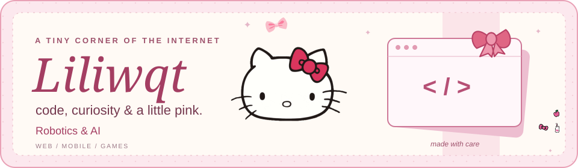

 

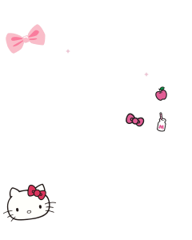
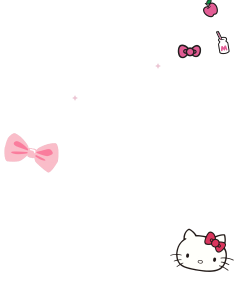

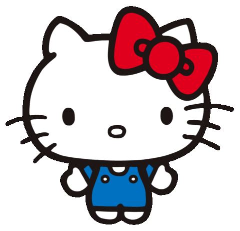&nbsp;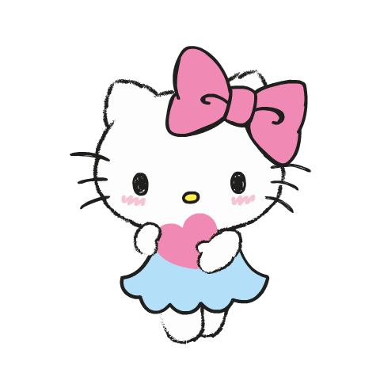&nbsp;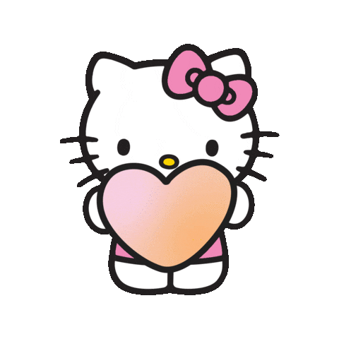

### hi, i'm Jhonryl.

Web, mobile, and games. 
Currently developing AI + robotics.

<a href="#my-project-shelf">my project shelf</a> &nbsp; · &nbsp; <a href="#what-im-exploring-next">what’s next</a> &nbsp; · &nbsp; <a href="#inside-my-toolbox">inside my toolbox</a> &nbsp; · &nbsp; <a href="https://github.com/Liliwqt?tab=repositories">all repositories</a>

<h2 id="my-project-shelf"> my project shelf </h2>

Tap a project to explore.

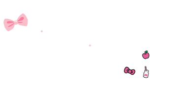
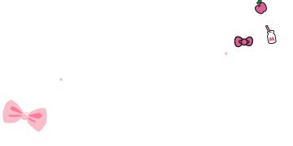

<a href="https://defense-simulator.onrender.com">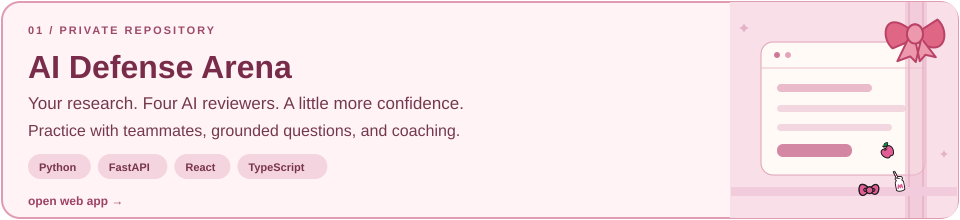</a>

<table>
<tr>
<td width="50%" valign="top">

<a href="https://github.com/Liliwqt/E-Menu">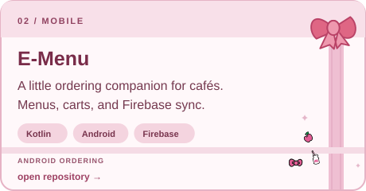</a>
</td>
<td width="50%" valign="top">

<a href="https://github.com/Liliwqt/E-Menu-Web">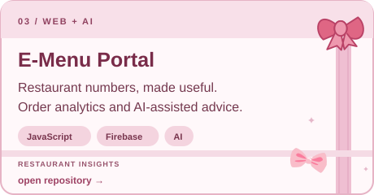</a>
</td>
</tr>
<tr>
<td width="50%" valign="top">

<a href="https://github.com/Liliwqt/GTB---UBEC">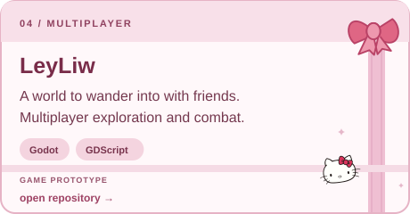</a>
</td>
<td width="50%" valign="top">

<a href="https://github.com/Liliwqt/TheHiddenBattleGame">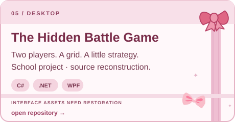</a>
</td>
</tr>
</table>

<a href="https://github.com/Liliwqt?tab=repositories"><b>browse the whole collection →</b></a>

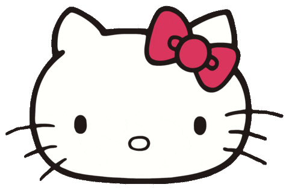

<h2 id="what-im-exploring-next"> everything that connects</h2>

Future builds: **AI / LLMs, robotics, and connected hardware.** 
The goal: **wireless, tiny, lightweight.** 
Less exposed wiring. Fewer modules. Only what matters.

<h2 id="inside-my-toolbox">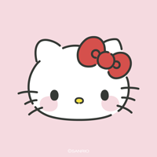 inside my toolbox </h2>

 &nbsp; &nbsp;  &nbsp; &nbsp; 

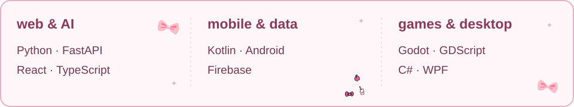

  

 <b>open a little note from me</b>

 

 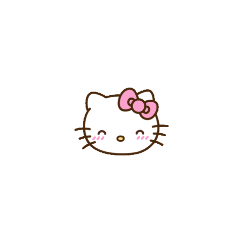 

Connecting ideas, code, and the physical world. 
Thanks for stopping by.

 

<a href="https://github.com/Liliwqt?tab=repositories">find your next favorite project →</a>

  

 <b>pick a project for your mood</b>

 

| if you're here for… | unwrap this one |
| :--- | :--- |
| AI and research | [AI Defense Arena](https://defense-simulator.onrender.com) — private repository |
| mobile experiences | [E-Menu](https://github.com/Liliwqt/E-Menu) |
| restaurant insights | [E-Menu Portal](https://github.com/Liliwqt/E-Menu-Web) |
| multiplayer worlds | [LeyLiw](https://github.com/Liliwqt/GTB---UBEC) |
| a little strategy | [The Hidden Battle Game](https://github.com/Liliwqt/TheHiddenBattleGame) — source reconstruction |

 

 

 &nbsp;  &nbsp; 

made with care, a little curiosity, and plenty of pink.

